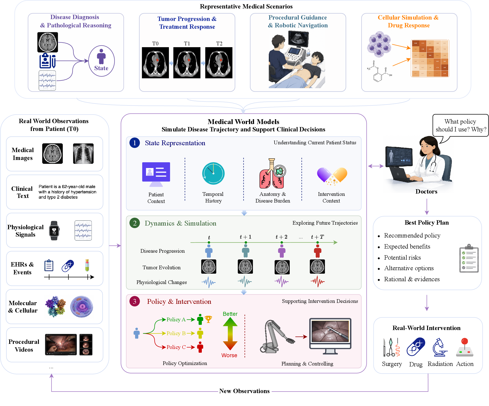

<div align="center">

# Medical world models: representing medical states, modelling clinical dynamics and guiding intervention policies

<p>
  <a href="https://arxiv.org/abs/2606.16721"></a>
  
  <a href="mailto:ke.liu@zju.edu.cn"></a>
</p>

</div>

## Overview
This repository tracks papers that directly support the medical world-model loop: representing medical states, modelling clinical dynamics, guiding intervention policies and composing these abilities into broader patient-, organ-, procedure- or biology-level simulators. It is intended as a focused companion list for medical world models rather than a general bibliography of world models, reinforcement learning, causality or foundation models.

<p align="center">
  
</p>

This list is actively maintained. If you find this repository useful, please consider citing our paper and starring the repository. If you know a relevant paper that is missing, contributions through issues or pull requests are welcome. For questions or suggestions, please contact [ke.liu@zju.edu.cn](mailto:ke.liu@zju.edu.cn).

```bibtex
@misc{liu2026medicalworldmodelsrepresenting,
      title={Medical world models: representing medical states, modelling clinical dynamics and guiding intervention policies}, 
      author={Ke Liu and Mengxuan Li and Yanyi Bao and Tianyun Zhang and Chong Chu and Jiajun Bu and Haishuai Wang},
      year={2026},
      eprint={2606.16721},
      archivePrefix={arXiv},
      primaryClass={cs.AI},
      url={https://arxiv.org/abs/2606.16721}, 
}
```

## Contents

The badges below indicate the modality, method type and available links used throughout the list.

| Tag group | Badges |
| --- | --- |
| Imaging |      |
| Clinical signals |    |
| Video and systems |      |
| Method and links |   [](#) [](#) |

- [Medical State Representation](#medical-state-representation)
- [Disease Progression and Trajectory Prediction](#disease-progression-and-trajectory-prediction)
- [Decision Support and Intervention Planning](#decision-support-and-intervention-planning)
- [Integrated Medical World Models](#integrated-medical-world-models)

---

## Medical State Representation

- **[X-WIN: Building Chest Radiograph World Model via Predictive Sensing](https://arxiv.org/abs/2511.14918)**  
    [](https://arxiv.org/abs/2511.14918)  
  **Venue/Time:** IEEE/CVF Conference on Computer Vision and Pattern Recognition (CVPR), 2026  
  **Authors:** Zefan Yang; Ge Wang; James Hendler; Mannudeep K. Kalra; Pingkun Yan  
  **Summary:** Frames chest radiograph pretraining as predictive sensing, using cross-view or structure-aware prediction to learn representations with volumetric context from 2D X-rays.

- **[CheXWorld: Exploring Image World Modeling for Radiograph Representation Learning](https://arxiv.org/abs/2504.13820)**  
    [](https://arxiv.org/abs/2504.13820) [](https://github.com/LeapLabTHU/CheXWorld)  
  **Venue/Time:** IEEE/CVF Conference on Computer Vision and Pattern Recognition (CVPR), 2025  
  **Authors:** Yang Yue; Yulin Wang; Chenxin Tao; Pan Liu; Shiji Song; Gao Huang  
  **Summary:** Builds a self-supervised radiograph world model that learns local anatomy, global layout, and domain variation knowledge for transferable chest X-ray representation learning.

- **[Xray2Xray: World Model from Chest X-rays with Volumetric Context](http://arxiv.org/abs/2506.19055)**  
    [](http://arxiv.org/abs/2506.19055)  
  **Venue/Time:** arXiv, 2025  
  **Authors:** Zefan Yang; Xinrui Song; Xuanang Xu; Yongyi Shi; Ge Wang; Mannudeep K. Kalra; Pingkun Yan  
  **Summary:** Learns 3D-aware chest X-ray representations by modeling projection transitions across viewing angles, improving downstream risk prediction and disease diagnosis.

- **[MedMod: Multimodal Benchmark for Medical Prediction Tasks with Electronic Health Records and Chest X-Ray Scans](https://proceedings.mlr.press/v248/elsharief24a.html)**  
    [](https://proceedings.mlr.press/v248/elsharief24a.html) [](https://github.com/nyuad-cai/MedMod)  
  **Venue/Time:** Conference on Health, Inference, and Learning (CHIL), 2025  
  **Authors:** Shaza Elsharief; Saeed Shurrab; L Julian Lechuga Lopez; Krzysztof J Geras; Farah E Shamout  
  **Summary:** Provides an open multimodal benchmark combining EHR and chest X-ray data across several clinical prediction tasks to evaluate multimodal medical learning methods.

- **[RadZero3D: Bridging Self-Supervised Video Models and Medical Vision-Language Alignment for Zero-Shot Chest CT Interpretation](https://doi.org/10.1109/iccvw69036.2025.00702)**  
   [](https://doi.org/10.1109/iccvw69036.2025.00702)  
  **Venue/Time:** IEEE/CVF International Conference on Computer Vision (ICCV), 2025  
  **Authors:** Jonggwon Park; Kyoyun Choi; Byungmu Yoon; Hong Geun Cho; Bumcheol Hwang  
  **Summary:** Uses self-supervised video representations and medical vision-language alignment to enable zero-shot interpretation of 3D chest CT volumes.

- **[CT2Rep: Automated Radiology Report Generation for 3D Medical Imaging](http://arxiv.org/abs/2403.06801)**  
   [](http://arxiv.org/abs/2403.06801) [](https://github.com/ibrahimethemhamamci/CT2Rep)  
  **Venue/Time:** Medical Image Computing and Computer Assisted Intervention (MICCAI), 2024  
  **Authors:** Ibrahim Ethem Hamamci; Sezgin Er; Bjoern Menze  
  **Summary:** Introduces a 3D chest CT report generation framework with a 3D vision encoder and autoregressive transformer, optionally incorporating prior-visit information.

- **[Brain-JEPA: Brain Dynamics Foundation Model with Gradient Positioning and Spatiotemporal Masking](http://arxiv.org/abs/2409.19407)**  
    [](http://arxiv.org/abs/2409.19407) [](https://github.com/Eric-LRL/Brain-JEPA)  
  **Venue/Time:** Conference on Neural Information Processing Systems (NeurIPS), 2024  
  **Authors:** Zijian Dong; Ruilin Li; Yilei Wu; Thuan Tinh Nguyen; Joanna Su Xian Chong; Fang Ji; Nathanael Ren Jie Tong; Christopher Li Hsian Chen; Juan Helen Zhou  
  **Summary:** Combines JEPA-style latent prediction, brain gradient positioning, and spatiotemporal masking to learn transferable brain dynamics representations from fMRI.

- **[BrainLM: A foundation model for brain activity recordings](http://biorxiv.org/lookup/doi/10.1101/2023.09.12.557460)**  
   [](http://biorxiv.org/lookup/doi/10.1101/2023.09.12.557460) [](https://github.com/vandijklab/BrainLM)  
  **Venue/Time:** International Conference on Learning Representations (ICLR), 2024  
  **Authors:** Josue Ortega Caro; Antonio H. De O. Fonseca; Christopher Averill; Syed A. Rizvi; Matteo Rosati; James L. Cross; Prateek Mittal; Emanuele Zappala; Daniel Levine; Rahul M. Dhodapkar; et al.  
  **Summary:** Pretrains a masked-prediction foundation model on large-scale fMRI recordings, enabling clinical variable prediction, future brain-state forecasting, and network discovery.

- **[EchoJEPA: A Latent Predictive Foundation Model for Echocardiography](https://arxiv.org/abs/2602.02603)**  
    [](https://arxiv.org/abs/2602.02603) [](https://github.com/bowang-lab/EchoJEPA)  
  **Venue/Time:** arXiv, 2026  
  **Authors:** Alif Munim; Adibvafa Fallahpour; Teodora Szasz; Ahmadreza Attarpour; River Jiang; Brana Sooriyakanthan; Maala Sooriyakanthan; Heather Whitney; Jeremy Slivnick; Barry Rubin; Wendy Tsang; Bo Wang  
  **Summary:** Introduces a JEPA-style echocardiography foundation model that predicts latent targets rather than pixels, aiming to learn anatomy-aware and artifact-robust ultrasound representations.

- **[Self-Supervised Ultrasound-Video Segmentation with Feature Prediction and 3D Localised Loss](http://arxiv.org/abs/2507.18424)**  
    [](http://arxiv.org/abs/2507.18424)  
  **Venue/Time:** SPIE Medical Imaging: Image Processing, 2026  
  **Authors:** Edward Ellis; Robert Mendel; Andrew Bulpitt; Nasim Parsa; Michael F. Byrne; Sharib Ali  
  **Summary:** Adapts V-JEPA-style feature prediction to ultrasound videos and adds a 3D localized loss so self-supervised pretraining improves segmentation with limited annotations.

- **[Structure-aware World Model for Probe Guidance via Large-scale Self-supervised Pre-train](https://arxiv.org/abs/2406.19756)**  
    [](https://arxiv.org/abs/2406.19756)  
  **Venue/Time:** International Workshop on Advances in Simplifying Medical Ultrasound (ASMUS), 2024  
  **Authors:** Haojun Jiang; Meng Li; Zhenguo Sun; Ning Jia; Yu Sun; Shaqi Luo; Shiji Song; Gao Huang  
  **Summary:** Learns structure-aware echocardiography representations through large-scale self-supervised world-model pretraining to support ultrasound probe guidance.

- **[Time and person sensitive foundation model for disease prediction and risk stratification](https://www.nature.com/articles/s41746-026-02524-6)**  
   [](https://www.nature.com/articles/s41746-026-02524-6) [](https://github.com/jaranwayne/RETFound-Plus.git)  
  **Venue/Time:** npj Digital Medicine, 2026  
  **Authors:** Zheyuan Wang; Yukun Zhou; Yilan Wu; Jocelyn Hui Lin Goh; Ke Zou; Zhouyu Guan; Yibing Chen; Gabriel Dawei Yang; Ping Zhang; Changchang Yin; et al.  
  **Summary:** Presents RETFound Plus, a temporal retinal foundation model trained on longitudinal fundus photographs to improve disease incidence prediction and risk stratification.

- **[From Video to EEG: Adapting Joint Embedding Predictive Architecture to Uncover Visual Concepts in Brain Signal Analysis](http://arxiv.org/abs/2507.03633)**  
    [](http://arxiv.org/abs/2507.03633) [](https://github.com/amir-hojjati/eeg-vjepa)  
  **Venue/Time:** arXiv, 2025  
  **Authors:** Amirabbas Hojjati; Lu Li; Ibrahim Hameed; Anis Yazidi; Pedro G. Lind; Rabindra Khadka  
  **Summary:** Adapts V-JEPA to EEG by treating EEG as video-like spatiotemporal sequences and learning joint-embedding representations through adaptive masking for EEG classification.

- **[Self-supervised pre-training with joint-embedding predictive architecture boosts ECG classification performance](https://linkinghub.elsevier.com/retrieve/pii/S0010482525011606)**  
    [](https://linkinghub.elsevier.com/retrieve/pii/S0010482525011606) [](https://github.com/kweimann/ECG-JEPA)  
  **Venue/Time:** Computers in Biology and Medicine, 2025  
  **Authors:** Kuba Weimann; Tim O.F. Conrad  
  **Summary:** Applies JEPA-style latent prediction to ECG pretraining, learning useful ECG representations without handcrafted augmentations or pixel-level reconstruction.

- **[JETS: A Self-Supervised Joint Embedding Time Series Foundation Model for Behavioral Data in Healthcare](https://openreview.net/forum?id=i4epRiMy8z)**  
   [](https://openreview.net/forum?id=i4epRiMy8z)  
  **Venue/Time:** NeurIPS Workshop on Learning from Time-Series for Health (TS4H), 2025  
  **Authors:** Erik Xie; Raquel Rodriguez Martinez; Wyatt Chang; Brandon Ballinger  
  **Summary:** Proposes a masked joint-embedding pretraining framework for noisy, sparse wearable behavioral time series and validates it on downstream diagnostic prediction tasks.

- **[EEG2Rep: Enhancing Self-supervised EEG Representation Through Informative Masked Inputs](https://dl.acm.org/doi/10.1145/3637528.3671600)**  
   [](https://dl.acm.org/doi/10.1145/3637528.3671600) [](https://github.com/Navidfoumani/EEG2Rep)  
  **Venue/Time:** ACM SIGKDD Conference on Knowledge Discovery and Data Mining (KDD), 2024  
  **Authors:** Navid Mohammadi Foumani; Geoffrey Mackellar; Soheila Ghane; Saad Irtza; Nam Nguyen; Mahsa Salehi  
  **Summary:** Introduces an EEG-specific masked self-supervised representation method that uses informative masked inputs to handle noisy and variable EEG signals.

- **[Deep Patient: An Unsupervised Representation to Predict the Future of Patients from the Electronic Health Records](https://www.nature.com/articles/srep26094)**  
   [](https://www.nature.com/articles/srep26094)  
  **Venue/Time:** Scientific Reports, 2016  
  **Authors:** Riccardo Miotto; Li Li; Brian A. Kidd; Joel T. Dudley  
  **Summary:** Learns unsupervised patient representations from large-scale EHRs, providing an early example of latent patient-state modelling for future clinical risk prediction.

- **[A Vision Foundation Model for Cataract Surgery Using Joint-Embedding Predictive Architecture](https://openreview.net/forum?id=H4R2d7F3Ks)**  
    [](https://openreview.net/forum?id=H4R2d7F3Ks)  
  **Venue/Time:** Medical Imaging with Deep Learning (MIDL), 2025  
  **Authors:** Nisarg A Shah; Mingze Xia; Subhasri Vijay; Shameema Sikder; S Swaroop Vedula; Vishal M Patel  
  **Summary:** Pretrains a JEPA-based surgical video foundation model on unlabeled cataract videos and evaluates it on step recognition, feedback, and skill assessment tasks.

- **[Hulu-Med: A Transparent Generalist Model towards Holistic Medical Vision-Language Understanding](https://arxiv.org/abs/2510.08668)**  
   [](https://arxiv.org/abs/2510.08668) [](https://github.com/ZJUI-AI4H/Hulu-Med)  
  **Venue/Time:** arXiv, 2025  
  **Authors:** Songtao Jiang; Yuan Wang; Sibo Song; Tianxiang Hu; Chenyi Zhou; Bin Pu; Yan Zhang; Zhibo Yang; Yang Feng; Joey Tianyi Zhou; et al.  
  **Summary:** Builds a transparent generalist medical vision-language model covering text, 2D images, 3D volumes, and videos through a unified and reproducible training pipeline.

- **[Lingshu: A Generalist Foundation Model for Unified Multimodal Medical Understanding and Reasoning](http://arxiv.org/abs/2506.07044)**  
   [](http://arxiv.org/abs/2506.07044) [](https://alibaba-damo-academy.github.io/lingshu/)  
  **Venue/Time:** arXiv, 2025  
  **Authors:** LASA Team; Weiwen Xu; Hou Pong Chan; Long Li; Mahani Aljunied; Ruifeng Yuan; Jianyu Wang; Chenghao Xiao; Guizhen Chen; Chaoqun Liu; et al.  
  **Summary:** Develops a generalist medical multimodal model with broader medical data coverage and reasoning-oriented training for unified medical understanding tasks.

- **[LLaVA-Med: Training a Large Language-and-Vision Assistant for Biomedicine in One Day](http://arxiv.org/abs/2306.00890)**  
   [](http://arxiv.org/abs/2306.00890) [](https://github.com/microsoft/LLaVA-Med)  
  **Venue/Time:** Conference on Neural Information Processing Systems (NeurIPS), 2023  
  **Authors:** Chunyuan Li; Cliff Wong; Sheng Zhang; Naoto Usuyama; Haotian Liu; Jianwei Yang; Tristan Naumann; Hoifung Poon; Jianfeng Gao  
  **Summary:** Adapts a general vision-language assistant to biomedicine using biomedical image-caption data and instruction tuning for open-ended biomedical visual conversation.

---

## Disease Progression and Trajectory Prediction

- **[CRONOS: Continuous Time Reconstruction for 4D Medical Longitudinal Series](https://arxiv.org/abs/2512.16577)**  
    [](https://arxiv.org/abs/2512.16577)  
  **Venue/Time:** arXiv, 2025  
  **Authors:** Nicolas A. Disch; Suprosanna Roy; Constantin Ulrich; Yannick Kirchhoff; Maximilian Rokuss; Robin Peretzke; Dorit Zimmerer; Klaus Maier-Hein  
  **Summary:** Forecasts 3D medical scans at arbitrary future timestamps by learning continuous-time spatiotemporal velocity fields from multiple past volumes.

- **[Temporal Flow Matching for Learning Spatio-Temporal Trajectories in 4D Longitudinal Medical Imaging](https://arxiv.org/abs/2508.21580)**  
    [](https://arxiv.org/abs/2508.21580)  
  **Venue/Time:** arXiv, 2025  
  **Authors:** Nicolas A. Disch; Yannick Kirchhoff; Robin Peretzke; Maximilian Rokuss; Suprosanna Roy; Constantin Ulrich; Dorit Zimmerer; Klaus Maier-Hein  
  **Summary:** Uses temporal flow matching to learn spatiotemporal trajectories in longitudinal medical imaging, supporting continuous-time image evolution modelling.

- **[Seq2Morph: A deep learning deformable image registration algorithm for longitudinal imaging studies and adaptive radiotherapy](https://aapm.onlinelibrary.wiley.com/doi/10.1002/mp.16026)**  
   [](https://aapm.onlinelibrary.wiley.com/doi/10.1002/mp.16026)  
  **Venue/Time:** Medical Physics, 2023  
  **Authors:** Donghoon Lee; Sadegh Alam; Jue Jiang; Laura Cervino; Yu‐Chi Hu; Pengpeng Zhang  
  **Summary:** Uses sequence-aware deformable registration to exploit spatial-temporal patterns in longitudinal imaging and adaptive radiotherapy workflows.

- **[MRI Contrast Enhancement Kinetics World Model](https://arxiv.org/abs/2602.19285)**  
    [](https://arxiv.org/abs/2602.19285) [](https://github.com/DD0922/MRI-Contrast-Enhancement-Kinetics-World-Model)  
  **Venue/Time:** IEEE/CVF Conference on Computer Vision and Pattern Recognition (CVPR), 2026  
  **Authors:** Jindi Kong; Yuting He; Cong Xia; Rongjun Ge; Shuo Li  
  **Summary:** Models MRI contrast enhancement as a kinetic world model, simulating contrast dynamics to improve the use of sparse and costly contrast-enhanced acquisitions.

- **[Brain Latent Progression: Individual-based Spatiotemporal Disease Progression on 3D Brain MRIs via Latent Diffusion](http://arxiv.org/abs/2502.08560)**  
   [](http://arxiv.org/abs/2502.08560) [](https://github.com/LemuelPuglisi/BrLP)  
  **Venue/Time:** Medical Image Analysis, 2025  
  **Authors:** Lemuel Puglisi; Daniel C. Alexander; Daniele Ravì  
  **Summary:** Generates individualized future 3D brain MRIs with latent diffusion to model spatiotemporal neurodegenerative disease progression.

- **[Learning Patient-Specific Disease Dynamics with Latent Flow Matching for Longitudinal Imaging Generation](http://arxiv.org/abs/2512.09185)**  
   [](http://arxiv.org/abs/2512.09185)  
  **Venue/Time:** arXiv, 2025  
  **Authors:** Hao Chen; Rui Yin; Yifan Chen; Qi Chen; Chao Li  
  **Summary:** Uses latent flow matching to learn patient-specific longitudinal imaging dynamics and generate future medical images along individualized disease trajectories.

- **[Pre to Post-Treatment Glioblastoma MRI Prediction using a Latent Diffusion Model](http://arxiv.org/abs/2510.17851)**  
   [](http://arxiv.org/abs/2510.17851)  
  **Venue/Time:** MICCAI Workshop on Deep Generative Models, 2025  
  **Authors:** Alexandre G. Leclercq; Sébastien Bougleux; Noémie N. Moreau; Alexis Desmonts; Romain Hérault; Aurélien Corroyer-Dulmont  
  **Summary:** Uses latent diffusion to predict post-treatment glioblastoma MRI from pre-treatment imaging, supporting simulation of treatment-related tumor change.

- **[Treatment-aware Diffusion Probabilistic Model for Longitudinal MRI Generation and Diffuse Glioma Growth Prediction](http://arxiv.org/abs/2309.05406)**  
   [](http://arxiv.org/abs/2309.05406) [](https://github.com/samleoqh/TaDiff-Net)  
  **Venue/Time:** IEEE Transactions on Medical Imaging, 2025  
  **Authors:** Qinghui Liu; Elies Fuster-Garcia; Ivar Thokle Hovden; Bradley J. MacIntosh; Edvard Grødem; Petter Brandal; Carles Lopez-Mateu; Donatas Sederevicius; Karoline Skogen; Till Schellhorn; Atle Bjørnerud; Kyrre Eeg Emblem  
  **Summary:** Generates longitudinal glioma MRIs with a treatment-aware diffusion model, capturing tumor growth and treatment-conditioned imaging changes.

- **[Prediction of Alzheimer's Disease Progression with Multi-Information Generative Adversarial Network](https://ieeexplore.ieee.org/document/9133262/)**  
   [](https://ieeexplore.ieee.org/document/9133262/)  
  **Venue/Time:** IEEE Journal of Biomedical and Health Informatics, 2020  
  **Authors:** Yan Zhao; Baoqiang Ma; Pengbo Jiang; Debin Zeng; Xuetong Wang; Shuyu Li  
  **Summary:** Predicts future 3D brain MRI and clinical stage in Alzheimer's disease using a multi-information GAN conditioned on baseline imaging and patient information.

- **[ImageFlowNet: Forecasting Multiscale Image-Level Trajectories of Disease Progression with Irregularly-Sampled Longitudinal Medical Images](http://arxiv.org/abs/2406.14794)**  
   [](http://arxiv.org/abs/2406.14794) [](https://github.com/KrishnaswamyLab/ImageFlowNet)  
  **Venue/Time:** IEEE International Conference on Acoustics, Speech and Signal Processing (ICASSP), 2025  
  **Authors:** Chen Liu; Ke Xu; Liangbo L. Shen; Guillaume Huguet; Zilong Wang; Alexander Tong; Danilo Bzdok; Jay Stewart; Jay C. Wang; Lucian V. Del Priore; Smita Krishnaswamy  
  **Summary:** Forecasts multiscale longitudinal medical image trajectories under irregular sampling, combining image-level dynamics with patient-specific disease progression modeling.

- **[Generative Medical Event Models Improve with Scale](http://arxiv.org/abs/2508.12104)**  
   [](http://arxiv.org/abs/2508.12104)  
  **Venue/Time:** arXiv, 2025  
  **Authors:** Shane Waxler; Paul Blazek; Davis White; Daniel Sneider; Kevin Chung; Mani Nagarathnam; Patrick Williams; Hank Voeller; Karen Wong; Matthew Swanhorst; et al.  
  **Summary:** Studies scalable generative models for longitudinal medical event sequences and shows that larger models improve patient timeline modeling from EHR data.

- **[Learning the Natural History of Human Disease with Generative Transformers](#)**  
   [](#)  
  **Venue/Time:** Nature, 2025  
  **Authors:** Artem Shmatko; Alexander Wolfgang Jung; Kumar Gaurav; Søren Brunak; Laust Hvas Mortensen; Ewan Birney; Tom Fitzgerald; Moritz Gerstung  
  **Summary:** Learns disease natural-history trajectories from large-scale health records using generative transformers, making longitudinal progression a modelled clinical object rather than a static endpoint.

- **[Foresight-a generative pretrained transformer for modelling of patient timelines using electronic health records: a retrospective modelling study](https://linkinghub.elsevier.com/retrieve/pii/S2589750024000256)**  
   [](https://linkinghub.elsevier.com/retrieve/pii/S2589750024000256) [](https://github.com/CogStack/Foresight)  
  **Venue/Time:** The Lancet Digital Health, 2024  
  **Authors:** Zeljko Kraljevic; Dan Bean; Anthony Shek; Rebecca Bendayan; Harry Hemingway; Joshua Au Yeung; Alexander Deng; Alfred Balston; Jack Ross; Esther Idowu; James T Teo; Richard J B Dobson  
  **Summary:** Pretrains a generative transformer on EHR timelines to model future clinical events and support disease prediction, diagnosis, and treatment-related forecasting.

- **[Disease Trajectory Maps](#)**  
   [](#)  
  **Venue/Time:** Conference on Neural Information Processing Systems (NeurIPS), 2016  
  **Authors:** Peter Schulam; Raman Arora  
  **Summary:** Models disease histories as trajectories, offering an early framework for representing and forecasting patient-level disease progression over time.

- **[Doctor AI: Predicting Clinical Events via Recurrent Neural Networks](https://proceedings.mlr.press/v56/Choi16.html)**  
   [](https://proceedings.mlr.press/v56/Choi16.html)  
  **Venue/Time:** Machine Learning for Healthcare (MLHC), 2016  
  **Authors:** Edward Choi; Mohammad Taha Bahadori; Andy Schuetz; Walter F. Stewart; Jimeng Sun  
  **Summary:** Uses recurrent neural networks to predict future diagnoses and medications from longitudinal patient visits, making EHR event forecasting a reusable clinical sequence modelling task.

- **[Surgical Vision World Model](http://arxiv.org/abs/2503.02904)**  
    [](http://arxiv.org/abs/2503.02904) [](https://github.com/bhattarailab/Surgical-Vision-World-Model)  
  **Venue/Time:** MICCAI Workshop on Data Engineering in Medical Imaging (DEMI), 2025  
  **Authors:** Saurabh Koju; Saurav Bastola; Prashant Shrestha; Sanskar Amgain; Yash Raj Shrestha; Rudra P. K. Poudel; Binod Bhattarai  
  **Summary:** Learns a latent surgical video world model with tokenization, latent actions, and dynamics prediction to simulate future surgical visual states.

- **[Towards Suturing World Models: Learning Predictive Models for Robotic Surgical Tasks](https://arxiv.org/abs/2503.12531)**  
     [](https://arxiv.org/abs/2503.12531) [](https://mkturkcan.github.io/suturingmodels/)  
  **Venue/Time:** arXiv, 2025  
  **Authors:** Mehmet Kerem Turkcan; Mattia Ballo; Filippo Filicori; Zoran Kostic  
  **Summary:** Trains predictive diffusion models for robotic suturing videos to model fine-grained surgical action dynamics and future visual outcomes.

---

## Decision Support and Intervention Planning

- **[DeepPrognosis: Preoperative prediction of pancreatic cancer survival and surgical margin via comprehensive understanding of dynamic contrast-enhanced CT imaging and tumor-vascular contact parsing](https://linkinghub.elsevier.com/retrieve/pii/S1361841521001961)**  
   [](https://linkinghub.elsevier.com/retrieve/pii/S1361841521001961)  
  **Venue/Time:** Medical Image Analysis, 2021  
  **Authors:** Jiawen Yao; Yu Shi; Kai Cao; Le Lu; Jianping Lu; Qike Song; Gang Jin; Jing Xiao; Yang Hou; Ling Zhang  
  **Summary:** Predicts pancreatic cancer survival and surgical margin status from dynamic contrast-enhanced CT by modeling tumor appearance and tumor-vascular contact.

- **[Autonomous Path Planning for Intercostal Robotic Ultrasound Imaging Using Reinforcement Learning](http://arxiv.org/abs/2404.09927)**  
    [](http://arxiv.org/abs/2404.09927) [](https://github.com/yuan-12138/Intercostal-US-RL)  
  **Venue/Time:** Scientific Reports, 2026  
  **Authors:** Yuan Bi; Cheng Qian; Zhicheng Zhang; Nassir Navab; Zhongliang Jiang  
  **Summary:** Trains a reinforcement learning agent in CT-derived virtual anatomy to plan intercostal ultrasound scanning paths around rib occlusions.

- **[EchoWorld: Learning Motion-Aware World Models for Echocardiography Probe Guidance](https://arxiv.org/abs/2504.13065)**  
    [](https://arxiv.org/abs/2504.13065) [](https://github.com/LeapLabTHU/EchoWorld)  
  **Venue/Time:** IEEE/CVF Conference on Computer Vision and Pattern Recognition (CVPR), 2025  
  **Authors:** Yang Yue; Yulin Wang; Haojun Jiang; Pan Liu; Shiji Song; Gao Huang  
  **Summary:** Learns motion-aware echocardiography world models that predict anatomical and visual changes caused by probe movement for adaptive probe guidance.

- **[Cardiac Copilot: Automatic Probe Guidance for Echocardiography with World Model](http://arxiv.org/abs/2406.13165)**  
    [](http://arxiv.org/abs/2406.13165)  
  **Venue/Time:** Medical Image Computing and Computer Assisted Intervention (MICCAI), 2024  
  **Authors:** Haojun Jiang; Zhenguo Sun; Ning Jia; Meng Li; Yu Sun; Shaqi Luo; Shiji Song; Gao Huang  
  **Summary:** Introduces Cardiac Dreamer, a world model of cardiac spatial structure, to provide real-time probe movement guidance for echocardiography.

- **[World Model Enhanced Offline Reinforcement Learning for Sequential Intervention Optimization in Acute Kidney Injury](https://media.sciltp.com/articles/2602002965/2602002965.pdf)**  
    [](https://media.sciltp.com/articles/2602002965/2602002965.pdf)  
  **Venue/Time:** AI Medicine, 2026  
  **Authors:** Bailing Zhang; Yuwei Mi  
  **Summary:** Combines a learned world model with offline reinforcement learning to optimize sequential AKI interventions while reducing unsafe clinical exploration.

- **[MedDreamer: Model-Based Reinforcement Learning with Latent Imagination on Complex EHRs for Clinical Decision Support](https://arxiv.org/abs/2505.19785)**  
   [](https://arxiv.org/abs/2505.19785)  
  **Venue/Time:** ACM SIGKDD Conference on Knowledge Discovery and Data Mining (KDD), 2026  
  **Authors:** Qianyi Xu; Gousia Habib; Feng Wu; Dilruk Perera; Mengling Feng  
  **Summary:** Learns latent EHR dynamics and uses model-based imagination to evaluate future trajectories for clinical decision support policies.

- **[G-Net: a Recurrent Network Approach to G-Computation for Counterfactual Prediction Under a Dynamic Treatment Regime](https://proceedings.mlr.press/v158/li21a)**  
   [](https://proceedings.mlr.press/v158/li21a)  
  **Venue/Time:** Machine Learning for Health (ML4H), 2021  
  **Authors:** Rui Li; Stephanie Hu; Mingyu Lu; Yuria Utsumi; Prithwish Chakraborty; Daby M. Sow; Piyush Madan; Jun Li; Mohamed Ghalwash; Zach Shahn; et al.  
  **Summary:** Implements g-computation with recurrent neural networks to predict counterfactual outcomes under dynamic, time-varying treatment regimes.

- **[SyncTwin: Treatment Effect Estimation with Longitudinal Outcomes](https://proceedings.neurips.cc/paper/2021/file/19485224d128528da1602ca47383f078-Paper.pdf)**  
   [](https://proceedings.neurips.cc/paper/2021/file/19485224d128528da1602ca47383f078-Paper.pdf) [](https://github.com/ZhaozhiQIAN/SyncTwin-NeurIPS-2021)  
  **Venue/Time:** Conference on Neural Information Processing Systems (NeurIPS), 2021  
  **Authors:** Zhaozhi Qian; Yao Zhang; Ioana Bica; Angela Mary Wood  
  **Summary:** Estimates longitudinal treatment effects by building a synthetic twin matched to a patient's pre-treatment trajectory and representation.

- **[Estimating Counterfactual Treatment Outcomes over Time through Adversarially Balanced Representations](https://openreview.net/forum?id=BJg866NFvB)**  
   [](https://openreview.net/forum?id=BJg866NFvB)  
  **Venue/Time:** International Conference on Learning Representations (ICLR), 2020  
  **Authors:** Ioana Bica; Ahmed M. Alaa; James Jordon; Mihaela van der Schaar  
  **Summary:** Learns balanced representations for time-varying treatment-effect estimation, supporting counterfactual clinical trajectory comparison under alternative treatment paths.

- **[The Artificial Intelligence Clinician Learns Optimal Treatment Strategies for Sepsis in Intensive Care](#)**  
   [](#)  
  **Venue/Time:** Nature Medicine, 2018  
  **Authors:** Matthieu Komorowski; Leo A. Celi; Omar Badawi; Anthony C. Gordon; A. Aldo Faisal  
  **Summary:** Learns sepsis treatment policies from intensive-care trajectories, providing an influential clinical example of sequential intervention optimization.

- **[DeepSurv: Personalized Treatment Recommender System Using a Cox Proportional Hazards Deep Neural Network](#)**  
   [](#)  
  **Venue/Time:** BMC Medical Research Methodology, 2018  
  **Authors:** Jared L. Katzman; Uri Shaham; Alexander Cloninger; Jonathan Bates; Tingting Jiang; Yuval Kluger  
  **Summary:** Extends survival modelling into personalized treatment recommendation by comparing predicted risk under alternative treatments.

- **[Continuous State-Space Models for Optimal Sepsis Treatment: A Deep Reinforcement Learning Approach](#)**  
   [](#)  
  **Venue/Time:** Machine Learning for Healthcare (MLHC), 2017  
  **Authors:** Aniruddh Raghu; Matthieu Komorowski; Leo Anthony Celi; Peter Szolovits; Marzyeh Ghassemi  
  **Summary:** Uses continuous state representations and deep reinforcement learning for sepsis treatment, linking patient-state modelling to policy learning in critical care.

- **[SurgWorld: Learning Surgical Robot Policies from Videos via World Modeling](https://arxiv.org/abs/2512.23162)**  
     [](https://arxiv.org/abs/2512.23162)  
  **Venue/Time:** arXiv, 2025  
  **Authors:** Yufan He; Pengfei Guo; Mengya Xu; Zhaoshuo Li; Andriy Myronenko; Dillan Imans; Bingjie Liu; Dongren Yang; Mingxue Gu; Yongnan Ji; et al.  
  **Summary:** Uses surgical video world modeling and inverse dynamics to construct action-conditioned data for learning surgical robot policies from videos.

- **[World Models for General Surgical Grasping](http://arxiv.org/abs/2405.17940)**  
     [](http://arxiv.org/abs/2405.17940) [](https://linhongbin.github.io/gas/)  
  **Venue/Time:** arXiv, 2024  
  **Authors:** Hongbin Lin; Bin Li; Chun Wai Wong; Juan Rojas; Xiangyu Chu; Kwok Wai Samuel Au  
  **Summary:** Presents GAS, a world-model-based reinforcement learning framework for robust pixel-level surgical grasping under object and system uncertainty.

- **[World Model for AI Autonomous Navigation in Mechanical Thrombectomy](https://papers.miccai.org/miccai-2025/1021-Paper3014.html)**  
     [](https://papers.miccai.org/miccai-2025/1021-Paper3014.html)  
  **Venue/Time:** Medical Image Computing and Computer Assisted Intervention (MICCAI), 2025  
  **Authors:** Harry Robertshaw; Han-Ru Wu; Alejandro Granados; Thomas C. Booth  
  **Summary:** Builds a world-model environment for mechanical thrombectomy navigation, enabling agents to learn catheter or guidewire actions across patient-specific vasculature.

---

## Integrated Medical World Models

- **[Medical World Model](http://arxiv.org/abs/2506.02327)**  
     [](http://arxiv.org/abs/2506.02327) [](https://github.com/scott-yjyang/MeWM)  
  **Venue/Time:** IEEE/CVF International Conference on Computer Vision (ICCV), 2025  
  **Authors:** Yijun Yang; Zhao-Yang Wang; Qiuping Liu; Shuwen Sun; Kang Wang; Rama Chellappa; Zongwei Zhou; Alan Yuille; Lei Zhu; Yu-Dong Zhang; Jieneng Chen  
  **Summary:** Combines treatment-plan generation, post-treatment tumor simulation, and survival-based evaluation to compare individualized cancer treatment strategies.

- **[Brain-WM: Brain Glioblastoma World Model](http://arxiv.org/abs/2603.07562)**  
    [](http://arxiv.org/abs/2603.07562) [](https://github.com/thibault-wch/Brain-GBM-world-model)  
  **Venue/Time:** arXiv, 2026  
  **Authors:** Chenhui Wang; Boyun Zheng; Liuxin Bao; Zhihao Peng; Peter Y. M. Woo; Hongming Shan; Yixuan Yuan  
  **Summary:** Unifies GBM future MRI generation and next-step treatment prediction in a shared latent world model to capture tumor-treatment co-evolution.

- **[CLARITY: Medical World Model for Guiding Treatment Decisions by Modeling Context-Aware Disease Trajectories in Latent Space](http://arxiv.org/abs/2512.08029)**  
     [](http://arxiv.org/abs/2512.08029) [](https://dingtianxingjian.github.io/clarity-project-page/?utm_source=catalyzex.com)  
  **Venue/Time:** arXiv, 2025  
  **Authors:** Tianxingjian Ding; Yuanhao Zou; Chen Chen; Mubarak Shah; Yu Tian  
  **Summary:** Forecasts treatment-conditioned oncology trajectories in structured latent space and links simulated trajectories to context-aware treatment recommendations.

- **[The UVA/PADOVA Type 1 Diabetes Simulator: New Features](#)**  
    [](#)  
  **Venue/Time:** Journal of Diabetes Science and Technology, 2014  
  **Authors:** Chiara Dalla Man; Francesco Micheletto; Dayu Lv; Marc Breton; Boris Kovatchev; Claudio Cobelli  
  **Summary:** Provides a mechanistic diabetes simulator for glucose-insulin dynamics and treatment-response testing, representing an important physiological simulation lineage.

- **[EHRWorld: A Patient-Centric Medical World Model for Long-Horizon Clinical Trajectories](http://arxiv.org/abs/2602.03569)**  
    [](http://arxiv.org/abs/2602.03569)  
  **Venue/Time:** arXiv, 2026  
  **Authors:** Linjie Mu; Zhongzhen Huang; Yannian Gu; Shengqian Qin; Shaoting Zhang; Xiaofan Zhang  
  **Summary:** Trains a patient-centric EHR world model under a causal sequential paradigm to maintain patient-state consistency during long-horizon clinical simulation.

- **[The Patient is not a Moving Document: A World Model Training Paradigm for Longitudinal EHR](https://arxiv.org/abs/2601.22128)**  
    [](https://arxiv.org/abs/2601.22128) [](https://huggingface.co/standardmodelbio/SMB-v1-1.7B-Structure)  
  **Venue/Time:** arXiv, 2026  
  **Authors:** Irsyad Adam; Zekai Chen; David Laprade; Shaun Porwal; David Laub; Erik Reinertsen; Arda Pekis; Kevin Brown  
  **Summary:** Reframes longitudinal EHR modeling as patient-state simulation rather than document continuation, using world-model training to preserve temporal patient dynamics.

- **[A Clinical Environment Simulator for Dynamic AI Evaluation](#)**  
    [](#)  
  **Venue/Time:** Nature Medicine, 2026  
  **Authors:** Luyang Luo; Sung Eun Kim; Xiaoman Zhang; Julius M. Kernbach; Roshan Kenia; Julian N. Acosta; Larry A. Nathanson; Adrian D. Haimovich; Adam Rodman; Ethan Goh; et al.  
  **Summary:** Builds a clinical environment simulator for dynamic AI evaluation, providing infrastructure for testing whether clinical agents can act safely across evolving patient scenarios.

- **[Beyond Generative AI: World Models for Clinical Prediction, Counterfactuals, and Planning](https://arxiv.org/abs/2511.16333)**  
    [](https://arxiv.org/abs/2511.16333)  
  **Venue/Time:** arXiv, 2025  
  **Authors:** Muhammad A. Qazi; Muhammad Nadeem; Muhammad Yaqub  
  **Summary:** Positions clinical world models as a route from generative prediction toward counterfactual reasoning, planning and intervention-aware clinical decision support.

- **[Towards building a World Model to simulate perturbation-induced cellular dynamics by AlphaCell](https://doi.org/10.64898/2026.03.02.709176)**  
    [](https://doi.org/10.64898/2026.03.02.709176)  
  **Venue/Time:** bioRxiv, 2026  
  **Authors:** Guohui Chuai; Xiaohan Chen; Xingbo Yang; Cheng Zhang; Kairu Qu; Wannian Li; Jingya Yang; Duanmiao Si; Feiyang Xing; Yicheng Gao; Shaliu Fu; Bing He; Qi Liu  
  **Summary:** Introduces AlphaCell, a virtual-cell world model that combines genome-wide representation and continuous state transitions to simulate perturbation responses.

- **[Lingshu-Cell: A Generative Cellular World Model for Transcriptome Modeling toward Virtual Cells](https://arxiv.org/abs/2603.25240)**  
    [](https://arxiv.org/abs/2603.25240)  
  **Venue/Time:** arXiv, 2026  
  **Authors:** H. Zhang; G. H. Yuan; C. Yuan; T. Xu; T. Bian; H. Cheng; W. Huang; D. Zhao; Y. Rong  
  **Summary:** Uses masked discrete diffusion to model transcriptomic state distributions and simulate perturbation-conditioned cell-state responses toward virtual-cell modelling.

- **[Artificial Intelligence Virtual Organoids (AIVOs)](#)**  
    [](#)  
  **Venue/Time:** Bioactive Materials, 2026  
  **Authors:** Long Bai; Jiacan Su  
  **Summary:** Frames virtual organoids as organoid-scale digital twins that combine virtual cells, multimodal longitudinal readouts and hybrid mechanistic modules for perturbation and drug-response simulation.

- **[GeneJepa: A Predictive World Model of the Transcriptome](https://doi.org/10.1101/2025.10.14.682378)**  
     [](https://doi.org/10.1101/2025.10.14.682378) [](https://github.com/BiostateAI/GeneJEPA)  
  **Venue/Time:** bioRxiv, 2025  
  **Authors:** Elon Litman; Tyler Myers; Vinayak Agarwal; Ekansh Mittal; Orion Li; Ashwin Gopinath; Timothy Kassis  
  **Summary:** Learns a JEPA-style predictive world model of single-cell transcriptomes by predicting latent representations of masked gene sets for perturbation-related tasks.

- **[Learning Action-Conditioned World Models for Cataract Surgery from Unlabeled Videos](https://openreview.net/forum?id=aYQYOVm2AB)**  
    [](https://openreview.net/forum?id=aYQYOVm2AB)  
  **Venue/Time:** Medical Imaging with Deep Learning (MIDL), 2026  
  **Authors:** Nisarg A. Shah; Mingze Xia; Shameema Sikder; S. Swaroop Vedula; Vishal M. Patel  
  **Summary:** Learns feature-space, action-conditioned surgical video dynamics from unlabeled cataract videos using latent action tokens and frozen visual representations.

- **[How Far Are Surgeons from Surgical World Models? A Pilot Study on Zero-Shot Surgical Video Generation with Expert Assessment](https://arxiv.org/abs/2511.01775)**  
    [](https://arxiv.org/abs/2511.01775)  
  **Venue/Time:** arXiv, 2025  
  **Authors:** Ziyi Chen; Qian Xu; Jiahao Wu; Beiyang Yang; Yuhang Zhai; Guoqing Guo; Jialin Zhang; Yuxin Ding; Nassir Navab; Jiebo Luo  
  **Summary:** Evaluates zero-shot surgical video generation with expert assessment, highlighting the gap between visually plausible surgical futures and clinically reliable surgical world models.

- **[From pre-treatment to post-operative care: Leveraging digital twins for precision surgery transformation](https://linkinghub.elsevier.com/retrieve/pii/S2352648325000819)**  
   [](https://linkinghub.elsevier.com/retrieve/pii/S2352648325000819)  
  **Venue/Time:** Smart Health, 2026  
  **Authors:** Farnaz Dehghan; Seyed Mojtaba Hosseini Bamakan; Mahboubeh Mirzabagheri; Alireza Naser Sadrabadi  
  **Summary:** Outlines a digital-twin framework spanning preoperative planning, intraoperative guidance, and postoperative monitoring for precision surgery.

- **[Medical Digital Twins: Enabling Precision Medicine and Medical Artificial Intelligence](#)**  
   [](#)  
  **Venue/Time:** The Lancet Digital Health, 2025  
  **Authors:** C. Sadee; S. Testa; T. Barba; K. Hartmann; M. Schuessler; A. Thieme; G. M. Church; I. Okoye; T. Hernandez-Boussard; L. Hood; et al.  
  **Summary:** Discusses how medical digital twins can connect individualized simulation, precision medicine and medical AI, while foregrounding translational and governance challenges.

- **[Digital Twins in Medicine](#)**  
   [](#)  
  **Venue/Time:** Nature Computational Science, 2024  
  **Authors:** Reinhard Laubenbacher; Behnam Mehrad; Ilya Shmulevich; Natalia Trayanova  
  **Summary:** Reviews medical digital twins as individualized simulators, clarifying a mechanistic and translational neighbour of learned medical world models.

- **[Digital twins for predictive oncology will be a paradigm shift for precision cancer care](https://www.nature.com/articles/s41591-021-01558-5)**  
   [](https://www.nature.com/articles/s41591-021-01558-5)  
  **Venue/Time:** Nature Medicine, 2021  
  **Authors:** Tina Hernandez-Boussard; Paul Macklin; Emily J. Greenspan; Amy L. Gryshuk; Eric Stahlberg; Tanveer Syeda-Mahmood; Ilya Shmulevich  
  **Summary:** Argues that oncology digital twins can integrate patient-specific data and simulation to forecast treatment response and support precision cancer care.

- **[In silico clinical trials: concepts and early adoptions](https://academic.oup.com/bib/article/20/5/1699/5032454)**  
   [](https://academic.oup.com/bib/article/20/5/1699/5032454)  
  **Venue/Time:** Briefings in Bioinformatics, 2019  
  **Authors:** Francesco Pappalardo; Giovanni Russo; Francesco M. Tshinanu; Marco Viceconti  
  **Summary:** Introduces in silico clinical trials as a translational simulation paradigm connecting mechanistic models, virtual cohorts and regulatory-facing evidence generation.

- **[The Virtual Physiological Human: Ten Years After](https://www.annualreviews.org/doi/10.1146/annurev-bioeng-110915-114742)**  
   [](https://www.annualreviews.org/doi/10.1146/annurev-bioeng-110915-114742)  
  **Venue/Time:** Annual Review of Biomedical Engineering, 2016  
  **Authors:** Marco Viceconti; Peter Hunter; Rod Hose  
  **Summary:** Reviews the virtual physiological human programme and its role in building multiscale, mechanistic simulation frameworks for individualized biomedical modelling.
